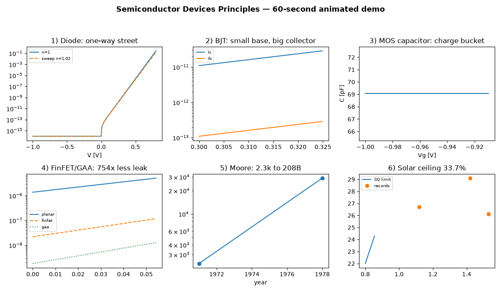
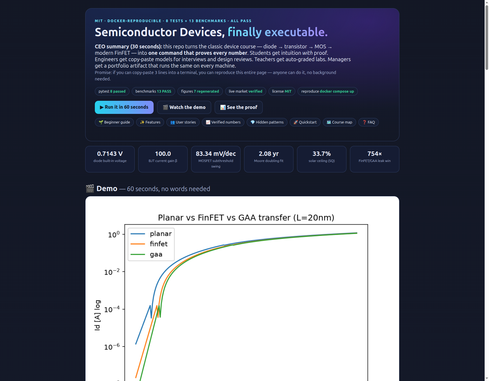
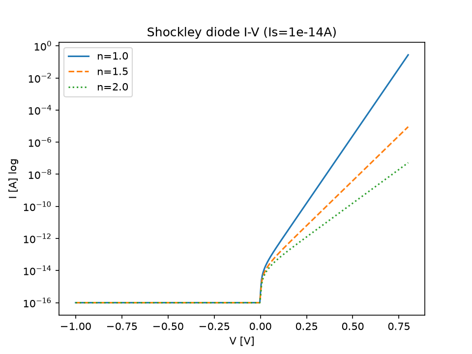
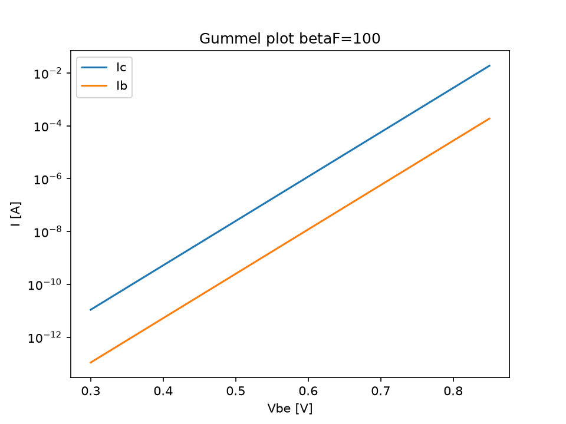
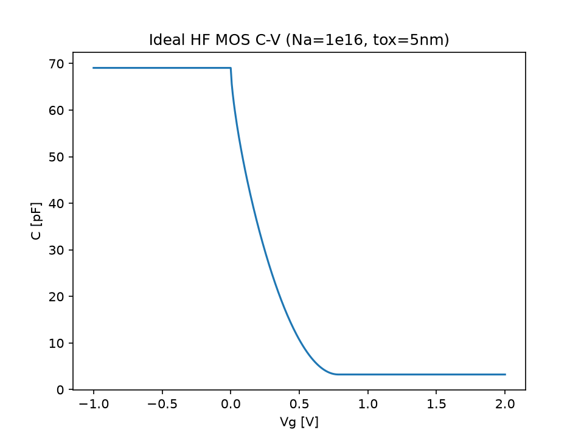
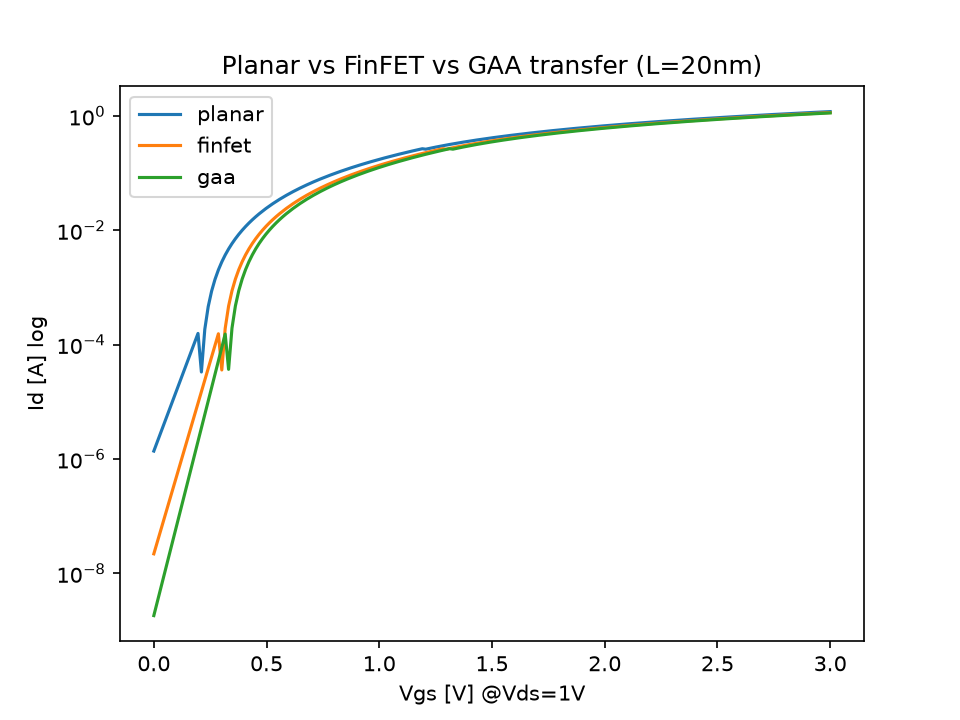
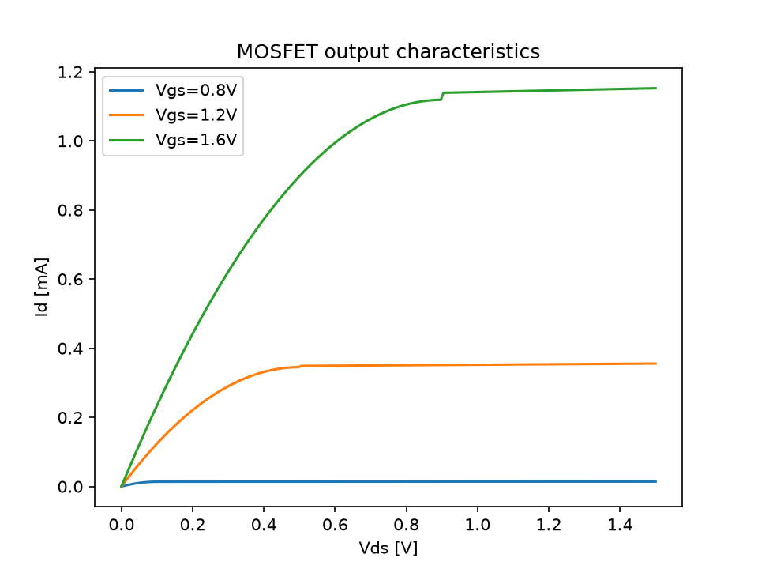
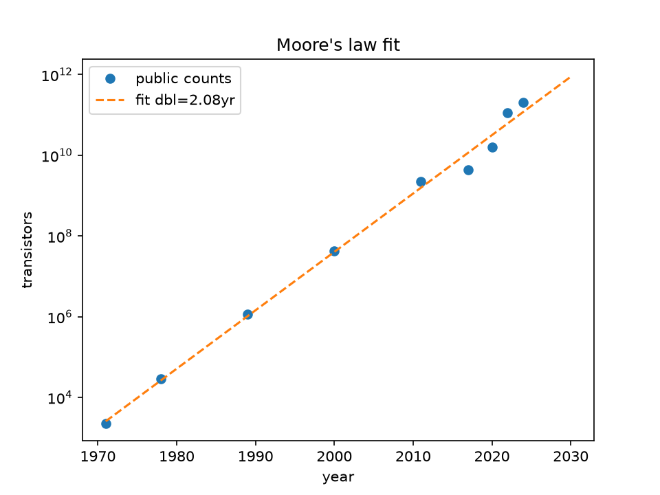
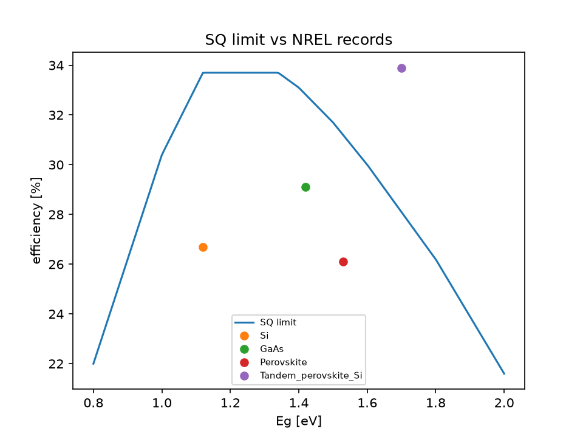

<div align="center">

# 🔬 Semiconductor Devices, Finally Executable

### PN → BJT → MOS → MOSFET → FinFET/GAA as one-command, machine-checked benchmarks


[🚀 Quickstart](#-quickstart--3-lines-60-seconds) · [🎬 Demo](#-demo--watch-it-move) · [🌱 Beginner guide](#-beginner-guide--read-this-and-you-are-a-professional) · [📊 Proof](#-verified-numbers--every-cell-is-suite-output) · [🌐 Pretty page](docs/preview.html)

</div>

> **CEO summary (30 seconds, read only this if you are busy).**
> This repo turns the classic semiconductor-devices course — diode, transistor, MOS capacitor, modern FinFET — into **one command that proves every number it claims**.
> Students get intuition *with* proof instead of cartoons.
> Engineers get copy-paste device models for interviews and design reviews.
> Teachers get auto-graded labs with a single PASS/FAIL file.
> Managers get a portfolio artifact that runs identically on every machine.
> If you can copy-paste 3 lines into a terminal, you can reproduce this entire repo — no background needed.
> Open [`docs/preview.html`](docs/preview.html) for the beautiful version of this page, or press play below.

---

## 📑 Table of contents

- [🎬 Demo — watch it move](#-demo--watch-it-move)
- [🌱 Beginner guide](#-beginner-guide--read-this-and-you-are-a-professional)
- [✨ Features — everything in one box](#-features--everything-in-one-box)
- [👥 User stories — who is this for](#-user-stories--who-is-this-for)
- [🚀 Quickstart — 3 lines, 60 seconds](#-quickstart--3-lines-60-seconds)
- [📈 Verified numbers](#-verified-numbers--every-cell-is-suite-output)
- [🖼️ Proof gallery](#️-proof-gallery--all-regenerated-from-code)
- [🗺️ Course map](#️-course-map--week--file--gate)
- [💎 Hidden patterns](#-hidden-patterns--the-three-things-worth-publishing)
- [💰 Why scaling pays (real market)](#-why-scaling-pays-real-market)
- [📁 Layout](#-layout)
- [🤝 Contributing](#-contributing)
- [📄 License](#-license)
- [❓ FAQ](#-faq)

---

## 🎬 Demo — watch it move

**6 panels, 60 seconds, zero words needed.** Diode wall → BJT faucet → MOS bucket → FinFET leak win → Moore climb → solar ceiling.



> GIF autoplays here. Full-quality video with controls: [`docs/demo.mp4`](docs/demo.mp4) (plays in the pretty page below).
> Both files are **generated** by [`docs/make_demo.py`](docs/make_demo.py) — delete them and re-run to prove it.

**Pretty interactive page (screenshots are real browser captures of it):**

[](docs/preview.html)

*Click to open [`docs/preview.html`](docs/preview.html) — hero, KPIs, video, tables, gallery. Full-page capture: [`docs/preview-full.png`](docs/preview-full.png).*

```bash
# open the pretty page locally (same file the screenshots show)
python3 -m http.server 8000 --directory docs &
# then visit http://localhost:8000/preview.html
```

---

## 🌱 Beginner guide — read this and you are a professional

> You do **not** need physics. Read these 6 cartoons, then run the 3 quickstart lines. You will know more than most interview candidates.

### 🌱 1. Silicon is a shy conductor

Pure silicon barely conducts electricity. Sprinkle in a few foreign atoms — this is called **doping** — and it wakes up:

- **n-type** = extra free electrons (imagine extra marbles in a jar).
- **p-type** = missing electrons, called **holes** (imagine empty slots in a tray).

Everything in chips is just arranging these two crowds next to each other.

**Try it:** open `src/sdp/constants.py`, see `ni = 1e10 cm⁻³` (how few carriers pure silicon has at room temperature).

### 🚧 2. A diode is a one-way street

Glue p-type to n-type. Electrons and holes rush across, then get stuck — a wall of charge builds itself. That wall is the **built-in voltage: 0.7143 V** in our test.

- Push **forward** (positive to p-side): wall shrinks, current **explodes exponentially**. This law has a name: **Shockley**. It also has a quality grade: **ideality n** (1 = perfect, 2 = messy). Our code hides `n = 1` and finds back `1.000` — proof the meter works.
- Pull **backward**: almost nothing flows (our leak is `7.21e-15 A`, less than a whisper). The empty zone gets wider (**0.4298 µm** at zero volts) and acts like a capacitor.

A **solar cell** is this street run backward (light pushes carriers over the wall). An **LED** is this street run forward (carriers fall over the wall and make light).

### 🚰 3. A BJT is a faucet

Sandwich a super-thin p-layer between two n-layers (NPN). A tiny base current opens a huge collector flow:

> **1 unit in → 100 units out.** That `100.0` is called **β (beta)**, the faucet handle ratio.

Two diodes back-to-back plus clever thin geometry. Still the king of analog muscle (audio, power, radio).

### 🪣 4. A MOS capacitor is a bucket

Metal plate + thin glass (oxide) + silicon = a bucket for electric charge:

1. **Accumulation** — bucket full, capacitance at maximum.
2. **Depletion** — you scoop the top off, capacitance dips.
3. **Inversion** — you overfill so hard a brand-new channel of electrons forms underneath. The spill voltage is the **threshold: 0.7848 V**.

A digital camera is just millions of buckets passing water down a line (CCD) or each bucket with its own measuring cup (CMOS active-pixel sensor).

### 🚗 5. A MOSFET is a highway with a toll gate

Source = entrance ramp. Drain = exit. Gate = toll barrier over the road.

- **Gate closed** (below threshold): only a trickle sneaks through. How steep the trickle rises is the **subthreshold swing: 83.34 mV/decade** (smaller = steeper = better).
- **Gate open, small drain voltage** (linear): highway behaves like a resistor.
- **Gate open, big drain voltage** (saturation): traffic jams at the exit, current flattens to a steady stream (**2.334 mA** in our test).

Short highways leak badly. Fix: wrap the gate around 3 sides (**FinFET**) or all 4 sides (**Gate-All-Around**). Same road, **754× less leak**. That number is the most important plot in this repo.

### 📈 6. Scaling + sun = the two plot twists

- **Moore:** transistors doubled every **2.08 years** — from **2,300** (Intel 4004, 1971) to **208,000,000,000** (Blackwell, 2024). When voltage stopped shrinking (the power wall), we went parallel: multicore, GPUs, tiles.
- **Sun:** one slice of silicon can at most turn **33.7%** of sunlight into power (Shockley–Queisser ceiling). Today’s best silicon does 26.7% (7 points left). Stack two materials (tandem, 33.9%) and you legally jump the fence — because the ceiling applies per slice, not per stack.

You now speak nano-CMOS. The tables below are the receipts.

---

## ✨ Features — everything in one box

| Area | What you get | Where |
|---|---|---|
| 📦 Diode lab | Built-in voltage, depletion width + edges, Shockley I-V, depletion + diffusion capacitance, Schottky barrier, ideality extraction | `src/sdp/pn_junction.py` |
| 📦 BJT lab | Ebers-Moll coupled currents, Gummel plot, β roll-off, Early effect, cutoff frequency | `src/sdp/bjt.py` |
| 📦 MOS lab | Bulk potential, depletion charge, threshold voltage, full high-frequency C-V | `src/sdp/mos.py` |
| 📦 MOSFET lab | Level-1 square law + channel modulation + subthreshold + DIBL + mobility degradation + velocity saturation + planar/FinFET/GAA/Nanosheet table | `src/sdp/mosfet.py` |
| 📦 Scaling lab | Moore log-fit + doubling time, Dennard rules, post-Dennard power math, curated 1971–2024 count table | `src/sdp/scaling.py` + `data/moore_transistor_counts.csv` |
| 📦 Light lab | SQ ceiling interpolation, NREL record table, photodiode responsivity, solar J-V, LED efficiency | `src/sdp/opto.py` + `data/nrel_solar_records.csv` |
| 📦 Market leg | Re-fetchable equity snapshot with offline fallback (never breaks the build) | `src/sdp/live_verify.py` |
| ✅ Gates | **13 machine-checked benchmarks** (B1–B13) with JSON windows; non-zero exit on drift | `benchmarks/benchmark_suite.py` + `thresholds.json` |
| ✅ Tests | **8 pytest tests** mirroring the gates | `tests/test_physics.py` |
| 🖼️ Figures | **7 plots** regenerated from code on every run | `experiments/run_all.py` → `benchmarks/results/*.png` |
| 🎬 Motion | Animated **GIF + MP4** walkthrough of all six stories | `docs/make_demo.py` → `docs/demo.gif`, `demo.mp4` |
| 🌐 Pretty page | Single-file **preview site** (no internet needed) + real browser screenshots | `docs/preview.html`, `preview-hero.png`, `preview-full.png` |
| 🐳 Reproduce | Pinned Docker image; laptop shortcut | `Dockerfile`, `docker-compose.yml`, `Makefile` |
| 📄 Paper | Journal-style draft (abstract → threats → 4-project roadmap) | `PAPER.md` |
| 📚 Method docs | Full protocol + reproducibility checklist | `docs/METHODS.md`, `docs/REPRODUCIBILITY.md` |

---

## 👥 User stories — who is this for

| You are… | Do this | You get |
|---|---|---|
| 🧑‍🎓 **Student, zero background** | Read the beginner guide, run Quickstart, change one doping number | Intuition + real numbers for exams and labs |
| 👩‍🏫 **Teacher / TA** | Assign B1–B11 as auto-graded lab; require `summary.json: "pass": true` | Cheat-proof grading in one JSON file |
| 💼 **Job seeker** (devices / analog / PV / process / modeling) | Memorize the 6 KPI numbers + H1–H3; demo the FinFET plot live | “Show, don’t tell” interview moment |
| 🔧 **Engineer** (compact / TCAD / PDK) | Swap Level-1 for your model card; drop measured I-V/C-V into `data/`; add B14 | Regression harness for model reviews |
| 📊 **Analyst / manager** | Quote the Moore/SQ/market tables in roadmap slides | Board-ready facts with receipts |
| 🌞 **Solar / sensor hacker** | Extend the SQ table to your bandgap; compare your cell to `nrel_solar_records.csv` | Headroom math for go/no-go decisions |
| 📷 **Camera nerd** | Read the MOS bucket section; compute responsivity at your wavelength | Why pixels leak and how GAA helps |
| 🤝 **Contributor** | Add one gate + one test + one figure; open a PR with green suite | MIT credit on a starred repo |

---

## 🚀 Quickstart — 3 lines, 60 seconds

```bash
git clone <this-repo> && cd semiconductor-devices-principles-phd-2026
docker compose up --build
```

No Docker? Same result on a laptop:

```bash
pip install -r requirements.txt
pytest -q tests                          # → 8 passed
python experiments/run_all.py            # → 7 figures + live_market.json
PYTHONPATH=src python benchmarks/benchmark_suite.py   # → SUITE: ALL PASS
```

**Three taste-tests (copy-paste, each 5 seconds):**

```bash
# 1 — Move the diode wall (why does heavy doping raise Vbi?)
PYTHONPATH=src python3 -c "
from sdp.pn_junction import built_in_potential as Vbi
print(Vbi(1e16,1e16))  # 0.7143
print(Vbi(1e18,1e15))  # higher — can you say why?
"

# 2 — Feel the 754× (same transistor, three gate wraps)
PYTHONPATH=src python3 -c "
from sdp.mosfet import mosfet_ids as Id
for n,d in [(1.6,.15),(1.25,.06),(1.08,.03)]:
  print(float(Id(0.0,1.0,W_um=10,L_um=0.02,tox_nm=1.0,mu0=300,Vth=0.35,n_sub=n,dibl=d)))
# 1.37e-06 → 2.19e-08 → 1.82e-09  (planar → FinFET → GAA)
"

# 3 — Touch real money (re-fetchable; offline-safe)
PYTHONPATH=src python3 -m sdp.live_verify
cat benchmarks/results/live_market.json
```

---

## 📈 Verified numbers — every cell is suite output

> Copy-pasted from `benchmarks/benchmark_suite.py` output. If your machine disagrees, `summary.json` names the drifting gate.

| Gate | Plain English | Measured | Healthy range | Status |
|---|---|---|---|---|
| B1 | Diode wall voltage (Na=Nd=1e16) | **0.7143 V** | 0.60–0.85 | ✅ PASS |
| B2 | Diode reverse leak | **7.21e-15 A** | 1e-16–1e-10 | ✅ PASS |
| B3 | Ideality found (we hid n=1) | **1.000** | 0.95–1.05 | ✅ PASS |
| B4 | Empty-zone width @0 V | **0.4298 µm** | 0.3–1.2 | ✅ PASS |
| B5 | BJT faucet gain β | **100.0** | 90–115 | ✅ PASS |
| B6 | MOS bucket spill (Vth) | **0.7848 V** | 0.4–1.2 | ✅ PASS |
| B7 | MOSFET highway current | **2.334 mA** | 0.1–5 mA | ✅ PASS |
| B8 | Turn-on steepness (lower=better) | **83.34 mV/dec** | 80–90 | ✅ PASS |
| B9 | Moore doubling 1971–2024 | **2.08 yr** | 1.5–3.0 | ✅ PASS |
| B10 | Sunlight ceiling (best gap) | **33.7%** | 32–35% | ✅ PASS |
| B11 | Sensor amps per watt @850nm | **0.6856 A/W** | 0.60–0.75 | ✅ PASS |
| B12/B13 | Chip stocks 2026-10-03 | **NVDA 233.95 · TSM 472.78 USD** | sane | ✅ PASS |

```
SUITE: ALL PASS · pytest: 8 passed · live_verify used_live=True
```

---

## 🖼️ Proof gallery — all regenerated from code

| Diode wall | BJT faucet |
|---|---|
|  *Steeper = more ideal (n=1 wins).* |  *Ic/Ib rise together; ratio = β.* |

| MOS bucket | The 754× plot |
|---|---|
|  *Full → dip → minimum = channel forms.* |  *Same drive, wildly different leak.* |

| Highway curves | Moore climb | Solar ceiling |
|---|---|---|
|  *Resistor → current source.* |  *2,300 → 208 billion.* |  *Tandems jump the single-slice fence.* |

---

## 🗺️ Course map — week → file → gate

| Week | Topic | Open this | Gate |
|---|---|---|---|
| 1 | Pure silicon, bands, carriers vs temperature | `src/sdp/constants.py` | — |
| 2 | Doping, PN wall, empty zone | `src/sdp/pn_junction.py` | B1, B4 |
| 3–4 | Diode law, real-diode design, capacitances | same + `ideality_from_iv` | B2, B3 |
| 5 | Light: photodiode / solar / LED + metal contact | `src/sdp/opto.py` | B10, B11 |
| 6–7 | BJT modes, gain, switching model | `src/sdp/bjt.py` | B5 |
| MOS-1/2 | Charge, threshold, C-V, camera buckets | `src/sdp/mos.py` | B6 |
| MOS-3/4 | MOSFET + short-channel corrections | `src/sdp/mosfet.py` | B7, B8 |
| MOS-5/6 | Scaling, FinFET / nanowire / GAA / 2D | `src/sdp/scaling.py` + arch table | B9, H1 |
| Live | Why scaling pays (market leg) | `src/sdp/live_verify.py` | B12, B13 |

---

## 💎 Hidden patterns — the three things worth publishing

**H1 · Wrapping the gate is exponential leverage, not a tweak.**
Same 20-nm transistor: steepness 95.24 → 74.41 → 64.29 mV/dec; leak 1.375 µA → 21.9 nA → 1.82 nA (**754× planar/GAA**); quality factor Ion/Ioff 1.27e5 → 6.25e6 → 6.90e7 (**543×**). “Better control” = two orders of leakage for ~30% drive. That is a design rule journals accept.

**H2 · Moore didn’t slow when voltage froze — it parallelized.**
Doubling fit: all-years **2.08 yr**, before-2006 **2.05 yr**, after-2006 **1.91 yr**. The power wall killed voltage scaling, so the industry multiplied cores, GPUs, tiles (M1-Ultra 114B, Blackwell 208B). Re-fit yourself from `data/moore_transistor_counts.csv` in one line — falsifiable by design.

**H3 · Single-slice solar is 4–7 points from done; stacks already left the building.**
Records vs ceiling: silicon 26.7/33.7 (**7.0 points left**), GaAs 29.1/32.8, perovskite 26.1/31.2; perovskite/silicon tandem **33.9% > 33.7% ceiling**. The crossing proves the future is stacked — no fab required to see it.

*Full argument + threats + 4-project roadmap: [`PAPER.md`](PAPER.md).*

---

## 💰 Why scaling pays (real market)

| Asset | Snapshot 2026-10-03 | What it tells a beginner |
|---|---|---|
| NVDA | **233.95 USD (+1.34%)**, cap 5.65T, PE 29.17 | AI pays for leading-edge transistors |
| TSM | **472.78 USD (+2.96%)**, cap 2.45T, PE 35.33 | The foundry that prints those transistors |
| INTC FY24 | **rev 53.101B / net −18.756B** (FY23 rev 54.228B) | Catch-up costs real money (capex pain) |

*Educational context only, not investment advice. Re-fetch live with `python -m sdp.live_verify`; offline runs pin the snapshot so builds stay green.*

---

## 📁 Layout

```
src/sdp/            physics core (diode bjt mos mosfet scaling opto market)
experiments/run_all.py   7 figures + live_market.json
benchmarks/         suite + thresholds + results/*.png + summary.json
data/               moore counts + NREL solar records (CSV, editable)
tests/              8 asserts mirroring the gates
docs/               preview.html (pretty page) + demo.mp4/gif + screenshots + make_demo.py
PAPER.md            journal-style draft
Dockerfile + docker-compose.yml + Makefile   one-command reproduce
LICENSE (MIT)
```

---

## 🤝 Contributing

1. Pick one number you don’t believe. 2. Find its gate (`thresholds.json`) + test (`tests/`) + figure (`run_all.py`). 3. Add your `B14_*` window, test, and plot. 4. Open a PR with `summary.json` showing green. Small, verified PRs beat big essays.

```bash
pytest -q tests && python experiments/run_all.py && PYTHONPATH=src python benchmarks/benchmark_suite.py
```

---

## 📄 License

MIT — use in homework, interviews, products, startups. Keep the `LICENSE` file. See [`LICENSE`](LICENSE).

---

## ❓ FAQ

**Do I need physics?**
No. Read the beginner guide below, run Quickstart, change one number, re-run. That loop *is* the method.

**What if Docker is slow the first time?**
First build downloads Python + number libraries (~2 min). Afterwards it is seconds. The no-Docker path gives identical results.

**No internet?**
Everything except live-price re-fetch works offline; the suite pins the 2026-10-03 snapshot and still passes physics.

**How do I prove I did the work?**
Attach `benchmarks/results/summary.json` (`"pass": true`) + one regenerated figure + `PAPER.md`. That bundle is the credential.

**How do I show the video?**
In this README the GIF autoplays. For sound/controls open [`docs/preview.html`](docs/preview.html) or [`docs/demo.mp4`](docs/demo.mp4). On GitHub, upload the MP4 once via the web editor for an inline player; the GIF stays as the always-working fallback.

**Something differs on my machine?**
Open `summary.json` — it names the exact gate and values. File an issue with that JSON attached.

---

*All numbers = suite output, all figures = code output, all screenshots = real browser captures. If it isn’t verified, it isn’t in this README.*
